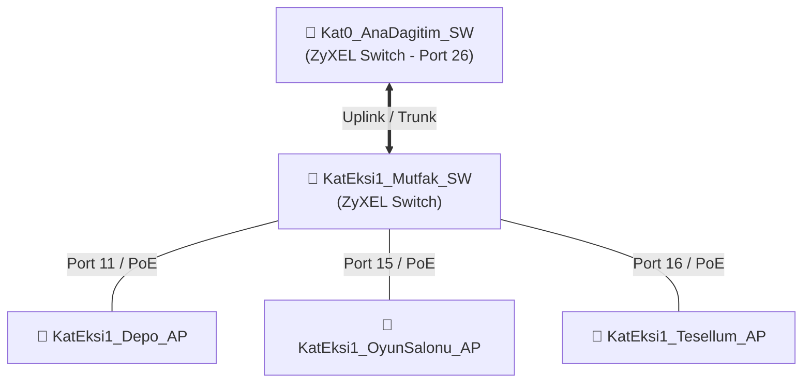

# OpenNCCM ZyXEL Port Mapper

**ZyXEL** yönetilebilir anahtarlarda (switch) hangi portta hangi cihazın bağlı olduğunu fiziksel olarak kablo takip etmeden tespit etmek, LLDP verilerini anlamlandırmak ve ağ topolojisini görselleştirmek için hazırlanmış açık kaynak çözüm rehberi ve şablon deposudur.

## 🎯 Çözülen Problem

Büyük veya çok katlı yapılarda ZyXEL switch'ler üzerinde zamanla port etiketleri kaybolabilir veya hangi portun hangi Access Point'e / Uplink hattına gittiği karışabilir. Bu proje, ZyXEL CLI üzerinden alınan ham `show lldp info remote` çıktısını okunabilir bir **port haritasına** ve **topoloji şemasına** dönüştürür.

## 🚀 Nasıl Çalışır? (Adım Adım)

### 1. ZyXEL Switch'ten LLDP Bilgisini Alma
ZyXEL switch'inize SSH veya Console ile bağlanın ve aşağıdaki komutu çalıştırın:

```text
ZyXEL-Switch# show lldp info remote
```

### 2. Örnek Çıktı Analizi
Komut sonucunda elde edilen ham veri aşağıdaki gibidir:

```text
LLDP Remote Device Information:
LocalPort            ChassisId              PortId       PortDesc     SystemName
  11   78:8a:20:XX:XX:XX   78:8a:20:XX:XX:XX             eth0     KatEksi1_Depo_AP
  15   fc:ec:da:XX:XX:XX   fc:ec:da:XX:XX:XX             eth0     KatEksi1_OyunSalonu_AP
  16   80:2a:a8:XX:XX:XX   80:2a:a8:XX:XX:XX             eth0     KatEksi1_Tesellum_AP
  26   b8:ec:a3:XX:XX:XX                  26              26       Kat0_AnaDagitim_SW
```

### 3. Port ve Cihaz Eşleştirme Tablosu
Yukarıdaki çıktı analiz edilerek MAC ön eklerinden (OUI) cihaz markaları ve görevleri çıkarılır:

| Yerel Port | Bağlı Cihaz Adı | MAC Ön Eki (OUI) | Uzak Port | Tespit Edilen Cihaz | Bağlantı Tipi |
| :--- | :--- | :--- | :--- | :--- | :--- |
| **11** | `KatEksi1_Depo_AP` | `78:8a:20` (Ubiquiti) | `eth0` | UniFi Access Point | PoE / Access |
| **15** | `KatEksi1_OyunSalonu_AP` | `fc:ec:da` (Ubiquiti) | `eth0` | UniFi Access Point | PoE / Access |
| **16** | `KatEksi1_Tesellum_AP` | `80:2a:a8` (Ubiquiti) | `eth0` | UniFi Access Point | PoE / Access |
| **26** | `Kat0_AnaDagitim_SW` | `b8:ec:a3` (ZyXEL) | `26` | ZyXEL Switch | Uplink / Trunk |

### 4. Görsel Topoloji Şeması (Mermaid)



## 🛠️ ZyXEL İpuçları ve Sorun Giderme

* **LLDP Görünmüyorsa:** ZyXEL switch üzerinde LLDP protokolünün global ve port bazlı aktif olduğundan emin olun (`lldp run` veya web arayüzünden *Basic Setting > LLDP*).
* **Uplink Tespiti:** Port ID kısmında `eth0` yerine doğrudan bir port numarası (örn. `26`) görüyorsanız, o hatta başka bir yönetilebilir switch bağlıdır.
* **Güvenlik Uyarısı:** Kendi çıktılarınızı bu repoya veya başka bir yere yüklerken MAC adreslerinin son 6 hanesini (`XX:XX:XX`) gizlemeyi unutmayın.

## 🤝 Katkıda Bulunma

Siz de kendi ZyXEL cihazlarınızdaki farklı LLDP çıktılarını ve çözümlerinizi **Pull Request** veya **Issue** açarak paylaşabilirsiniz.
